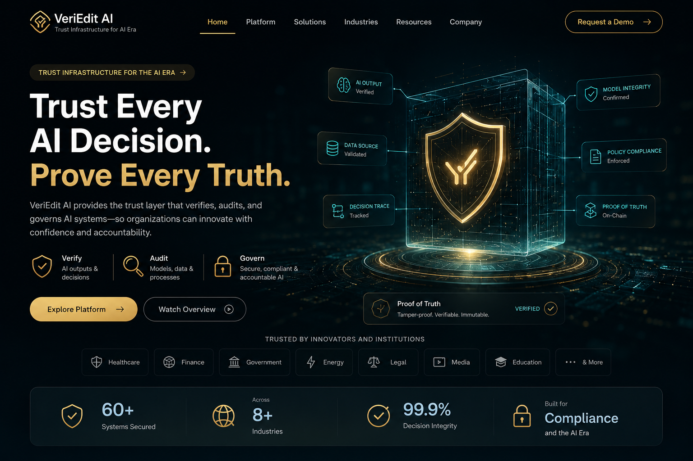

# VeriEdit AI

## Trust Infrastructure for Artificial Intelligence

VeriEdit AI is a trust infrastructure platform designed to help organizations verify, audit, and govern AI-generated outputs before they become business decisions.

As artificial intelligence becomes increasingly integrated into critical industries, organizations require systems that improve transparency, accountability, and confidence in AI-assisted workflows.

VeriEdit AI provides structured verification, evidence analysis, and governance capabilities that help transform AI from a black box into a trustworthy decision-support system.

---

# The Problem

Artificial intelligence is increasingly used to support decisions across healthcare, finance, legal services, education, government, and enterprise operations.

However, organizations often struggle to answer fundamental questions:

- Can this AI response be trusted?
- What evidence supports this output?
- How should AI-generated information be reviewed?
- How can AI decisions be governed responsibly?

Without structured verification, AI systems can introduce unnecessary risk into critical workflows.

---

# The Solution

VeriEdit AI introduces a trust layer between AI-generated information and human decision-making.

Instead of replacing human judgment, the platform helps users verify information, organize supporting evidence, and improve confidence before important decisions are made.

---

# Core Capabilities

## AI Output Verification

Review and evaluate AI-generated responses before they are relied upon.

## Evidence Organization

Structure supporting information into clear and reviewable formats.

## Decision Support

Provide contextual information that helps users make informed decisions.

## AI Governance

Support responsible AI adoption through transparency, review, and structured workflows.

## Domain Integration

The verification engine can be integrated into domain-specific applications such as healthcare, legal technology, finance, education, and enterprise software.

---

# Platform Ecosystem

VeriEdit AI serves as the trust infrastructure powering multiple intelligent systems.

Applications built on the platform include:

- HealLink
- VeriLex

Future integrations may extend into additional industries where trustworthy AI is essential.

---

# Technology Stack

## Frontend

- React
- Next.js
- TypeScript

## Backend

- Node.js
- REST APIs

## Artificial Intelligence

- Large Language Models
- Prompt Engineering
- AI Verification Workflows
- Decision Support Systems

## Infrastructure

- GitHub
- Render
- Cloud Deployment

---

# Architecture

User Request

↓

AI Processing

↓

VeriEdit AI Verification Layer

↓

Evidence Review

↓

Structured Response

↓

Human Decision

---

# Roadmap

Current

- AI verification workflows
- Structured evidence analysis
- Trust-oriented AI architecture

Planned

- Enterprise governance dashboard
- Verification APIs
- Multi-model support
- Explainability improvements
- Compliance reporting
- Organization workspaces

---

# Vision

Artificial intelligence should not only generate answers.

It should help people make trustworthy decisions.

VeriEdit AI is building the infrastructure that helps organizations adopt AI responsibly, transparently, and with greater confidence.
